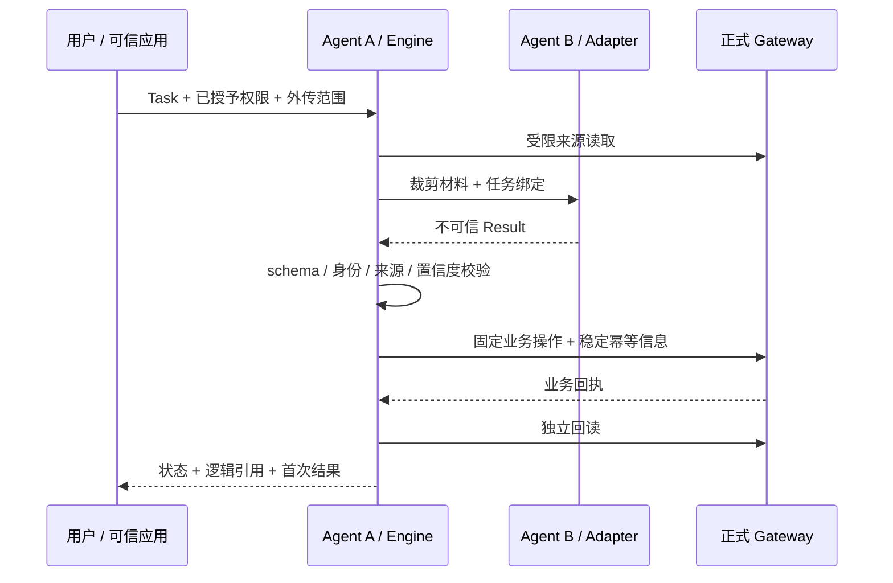

# Agent A 管理 Agent B：编排层使用与边界

这是未发布的、需要宿主应用显式接线的 Python SDK。核心和三域在合成 Gateway 上验证；当前 Desktop MCP 生产验收与真实 DeepSeek 模型执行仍未通过。它不自动修改安装配置，也未新增 Desktop 可发现的编排工具。

## 组件与调用

`orchestration.models` 定义任务、结果、描述符和回执；`adapters` 注册执行器并区分 CONFIGURED、CONNECTED、VERIFIED；`engine` 负责策略、有限调用、候选校验、Gateway 提交、独立回读；`journal` 仅保存任务元数据。`domains` 固定业务映射，`harness` 是明确阻断的接入骨架，不能调用模型。



Task 的 `grants` 是可信应用传入的任务范围，**不是身份认证**；Gateway 的 capability 检查仍是最终边界。不能把用户来源正文或模型输出反序列化成带授权的 Task。`external_allowed=True` 表示调用方已明确同意该任务材料向外部适配器传输；默认 False，准备材料、健康检查和执行均不会在拒绝之后进行。适配器代码本身是受信插件，Python SDK 无法隔离任意恶意 Python 代码。

注册器记录声明能力；健康检查成功只能变为 CONNECTED，结构及 domain 校验成功才记录对应任务类型 VERIFIED。合成执行器的 scope 必须标为 synthetic，不能把测试回执解释为真实模型证据。自动路由按任务类型、required_capabilities、外传授权筛选，优先本地和已经验证的候选；恢复保持原执行器及版本。

## 接线示例

下例要求已有正式连接的 session 和应用提供的受信 adapter；不包含启动客户端、生产配置覆盖或直接数据库访问。合成完整示例在 `tests/test_orchestration_domains.py::test_engine_domain_integration`，覆盖五种任务类型。

```python
from cognivault.orchestration import Engine, FileJournal, Registry, Task
from cognivault.orchestration.domains import (
    MCPGatewayPort, StudyAnalysisHandler, HistorySummaryHandler,
    HistoryIngestHandler, MemoryProposalHandler, ThreeDomainRetrievalHandler,
)

def compose(existing_session, trusted_adapter, private_journal_directory):
    port = MCPGatewayPort(existing_session)
    registry = Registry()
    registry.register(trusted_adapter)
    return Engine(registry, FileJournal(private_journal_directory), {
        "study.analyze": StudyAnalysisHandler(port),
        "history.summarize": HistorySummaryHandler(port),
        "history.ingest": HistoryIngestHandler(port),
        "memory.propose": MemoryProposalHandler(port),
        "evidence.retrieve": ThreeDomainRetrievalHandler(port),
    })

async def analyze(engine, task_id, source_id):
    task = Task(task_id, task_id, "study.analyze", {"source_id": source_id},
                frozenset({"read", "write"}))
    return await engine.run(task)  # 或明确传入注册的 agent_id
```

`InProcessGatewayPort` 用于明确的 SDK 接线和隔离合成验收，不能在当前 Desktop Gateway 缺失时作为生产数据读取替代。所有模型返回的工具名、权限字段、额外结构和来源替换均拒绝；文本中的指令只当作文本，不执行。

## 任务契约

| kind | 可信 inputs | B 的 output | Gateway 行为 |
| --- | --- | --- | --- |
| study.analyze | source_id；可选 expected_version、source_refs、study_relations、include_source | analysis 的五个规范字段、source_refs、study_relations | save_wrong_answer_analysis，按保存版本回读 |
| history.summarize | item_id | summary、source_refs、原文 content_sha256 | 原文读取与指纹回读；摘要仅在本次回执中返回 |
| history.ingest | relative_manifest、expected_manifest_sha256；可选 cursor、limit | manifest_sha256、approved=True | Gateway 校验 manifest 并无损导入，逐来源 hash/字节数回读 |
| memory.propose | source_ref（history 或 canonical message） | quote、subject、predicate、value、classification、basis | 原文校验、提议候选、冲突检测、回读；始终待审 |
| evidence.retrieve | queries（三域聚焦查询）；可选 limit | selected_refs | retrieve_evidence；保留 COMPLETE/NO_EVIDENCE/PARTIAL/UNAVAILABLE |

History 的 approved 是模型结构字段，不授予导入权限；操作来自可信 Task 的 ingest 授权与固定 manifest。模型不能提供或改写原始聊天。导入单任务处理一个有界页面；`has_more` 保持 PARTIAL，调用方用新 task_id 和明确的下一 cursor 继续。没有自动递归规划。

Memory 当前正式候选入口要求 History 原文作为主来源。Study-only 候选生成和任意来源记忆提取未接入；不能为统一接口绕过该规则。语义冲突检测仍以现有 Gateway 的有限匹配与审阅为准，不能证明事实当前正确。Memory 候选 API 没有 provenance 参数，任务日志保存 candidate_id 关联，不能声称业务候选内新增了 Agent 身份。

Study 处理已经正式注册的材料和错题来源；初始资产注册与题目转录继续遵循 `study-workflow://wrong-answer`。不将无法识别的原文、推断分数或长期习惯变成已确认事实。

需要原文材料时，可信调用方显式设置 `include_source=True`。文档来源通过 Gateway 获取对应页面文本；图片来源仅接收 PNG/JPEG/WebP，限 1 MiB，以最多 16 个 65536 字节块读取并核对完整 SHA-256。图片任务还必须声明 `required_capabilities=frozenset({'image', 'structured'})`，执行器需匹配。材料仅进入裁剪后的 prepared，未写入任务日志；真实图片识别准确性尚未验证。

## 恢复、审阅与结果保留

同一 task_id 的输入、授权、关联 ID、重试参数和执行器绑定不可改变。相同任务重放不会再次运行模型或产生新的业务版本。内核只在 Agent 阶段做最多 1–5 次自动重试，不自动重试未知写入结果。

日志目录需由应用配置在私有、受访问控制的位置，通常为被忽略的 `var/orchestration`。Windows 访问控制继承父目录；SDK 不代替管理员配置 ACL。日志保存阶段、UTC 时间、请求/候选/回执指纹、计数及逻辑业务 ID/版本；不保存图片、聊天正文、模型分析或 Gateway 原文。首次 `Receipt.output` / `gateway_receipt` 返回完整结果，repr 不打印它们；应用应按自己的隐私策略保留必要结果。完成后重放只恢复元数据与逻辑引用，不能重建未保存的摘要。

写入前持久化候选指纹。COMMITTING / VERIFYING 中断后，可信调用方使用 `engine.run(task, agent_id, resume_result=original_result)` 提交完全相同的 Result，才允许原样重放固定幂等操作及回读。未提供时为 WAITING_FOR_REVIEW/RESUME_RESULT_REQUIRED；不同候选拒绝，不能重新调用模型后直接写入。原候选未由应用保存时，只能人工按 Gateway 回执检查并另建审核任务，不能从元数据反推出正文。

Memory 回读成功后 WAITING_FOR_REVIEW 表示**候选已保存、仍需正式审核**，不是事实已写入。低置信度、缺证据或显式不确定性在提交前停下；审核后需单独任务，不提供放宽校验的 resume 开关。写入后的取消、超时和回读不匹配保持 PARTIAL。

异步执行器必须合作取消。内核给予有界清理时间，未停止则停止重试、观察遗留异常并报告 CANCELLATION_STALLED；无法强杀进程内 Python。硬隔离和进程树回收属于真实执行器接入前置条件。同步 SDK Gateway 方法可能阻塞事件循环；网络生产接线应使用可取消的 MCP session。

Study 旧版本回读按版本定位分页；若超过正式 Gateway 的 offset 上限 1000，保留 PARTIAL，不私查 store。结果结构校验和来源可用不等于模型语义正确，低置信度阈值也不是准确率承诺。

调查、真实模型限制及验收分别见 [环境报告](agent-orchestration-environment.md)、[Harness 报告](agent-orchestration-harness.md)、[交付检查点](checkpoints/2026-10-24-agent-orchestration.md)。
